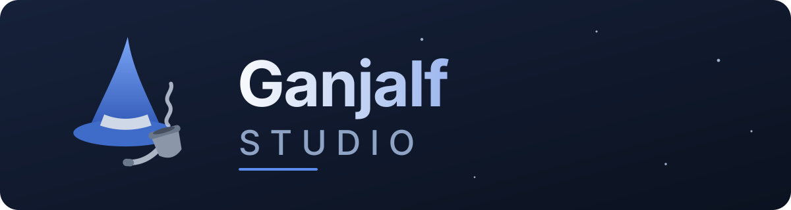

<p align="center">
  
</p>

<h3 align="center">Ganjalf Studio: un fork di Unsloth Studio con skill <code>SKILL.md</code>, un agente più affidabile sui modelli locali e una nuova veste grafica.</h3>

<p align="center">
  <a href="#-novità">Novità</a> •
  <a href="#-le-skill">Skill</a> •
  <a href="#-avvio">Avvio</a> •
  <a href="#-licenza-e-crediti">Licenza</a>
</p>

> **Progetto non ufficiale.** Ganjalf Studio è un fork indipendente di [Unsloth](https://github.com/unslothai/unsloth) e non è affiliato a Unsloth AI. Per documentazione, modelli e supporto del progetto originale vedi [unsloth.ai/docs](https://unsloth.ai/docs).

## ✨ Novità

- **Import delle skill**: dalla finestra *Skills* importi un singolo `SKILL.md`, più file scelti insieme, una cartella trascinata sulla lista o un archivio ZIP.
- **Skill scelta dal motore**: se la richiesta corrisponde chiaramente a una skill attiva, il backend ne carica le istruzioni complete prima di generare, come se l'avessi nominata con `@`. I modelli locali piccoli spesso non chiamano `read_skill` o aprono la skill sbagliata.
- **Skill di serie**: al primo avvio `coding-agent` (flusso di lavoro sul codice: leggere i file grandi a pezzi, riprodurre, correggere, verificare) viene copiata tra le tue skill e `skill-creator` viene attivata, così il modello può scrivere le skill di cui ha bisogno.
- **Istruzioni fissate nel contesto**: quando la finestra di contesto scorre, le ultime due istruzioni dell'utente restano nel prompt, così il modello non perde il compito a metà lavoro.
- **Tema e identità Ganjalf**: palette grigio-argento con accento blu freddo (chiara e scura), nuova mascotte (cappello blu e pipa grigia), logo in barra laterale, icona e titolo della scheda. Le palette con nome di Unsloth restano disponibili.
- **Tutto il resto di Unsloth Studio**: esecuzione e addestramento di modelli, chat, agenti e strumenti, API compatibile con OpenAI, RAG e ricerca.

## 📜 Le skill

Una skill è una cartella con un file `SKILL.md`: un blocco YAML iniziale con `name` e `description`, poi le istruzioni in Markdown.

```markdown
---
name: revisore-codice
description: Rivede una modifica e segnala bug, test mancanti e problemi di stile.
---
Quando l'utente chiede una revisione, leggi prima il diff e poi…
```

- **Dove vivono**: di default in `~/.agents/skills`; la cartella si cambia con la variabile `UNSLOTH_STUDIO_SKILLS_HOME`. Studio legge anche `~/.claude/skills` e alcune skill incluse.
- **Come le conosce il modello**: nel prompt entra un catalogo con nome e descrizione delle skill attive. Il testo completo si carica quando scrivi `@nome-skill`, quando il modello lo richiede, oppure quando il motore riconosce che la richiesta corrisponde a una skill.
- **Scelta automatica**: il motore confronta la richiesta con nome e descrizione di ogni skill attiva (sovrapposizione di termini, senza modelli né rete) e carica una sola skill, solo se batte nettamente le altre e condivide almeno tre termini con la richiesta. Scrivi la descrizione con le parole che userebbe chi ha bisogno di quella skill, anche in italiano. Si spegne con `GANJALF_AUTO_SKILLS=0`; una skill può escludersi con `metadata: {auto-load: "false"}` nel blocco YAML. Se la modalità dei permessi chiede conferma, il caricamento passa dalla stessa approvazione di un `@`.
- **Creare skill**: la skill inclusa `skill-creator` insegna al modello a scriverne di nuove ed è attiva di serie con lo script di avvio.
- **Importare**: pulsante *Import* (anche più file insieme) oppure trascina file e cartelle sulla lista. Limiti: 20 MB e 500 file per importazione. I file e le cartelle nascosti (che iniziano con `.`) nelle cartelle trascinate vengono ignorati.
- **Nome duplicato**: una skill importata con lo stesso nome di una inclusa finisce in `~/.agents/skills` e la nasconde.

## 🚀 Avvio

Da utente normale (non root), dentro il repository clonato:

```bash
git clone https://github.com/Hubert9204/Ganjalf-Studio
cd Ganjalf-Studio
bash scripts/ganjalf-launch.sh
```

Lo script tiene dati e ambiente in `~/.ganjalf-studio` (separati da un eventuale Unsloth Studio), installa da questo repository al primo avvio, sceglie la prima porta libera da `8890` e apre il browser. L'installazione scarica diversi GB; la GPU NVIDIA viene riconosciuta da sola. Variabili utili: `GANJALF_HOME`, `GANJALF_PORT`, `GANJALF_NO_BROWSER=1`, `GANJALF_AUTO_SKILLS=0`, `ROLLING_INSTRUCTION_PIN_GROUPS=0` (spegne le istruzioni fissate) e `UNSLOTH_NO_TORCH=1` (solo GGUF, installazione molto più piccola).

**Docker**: `docker/Dockerfile.studio` clona Studio da questo fork (argomento di build `UNSLOTH_STUDIO_REPO`). Con una GPU NVIDIA serve il NVIDIA Container Toolkit e l'opzione `--gpus all`.

```bash
docker buildx build -f docker/Dockerfile.studio -t ganjalf-studio docker/
docker run --rm --gpus all -p 8000:8000 -v ganjalf-data:/opt/unsloth-studio ganjalf-studio
```

In Docker lo script di avvio non gira: le skill di serie vengono copiate nel volume a ogni avvio del container, le variabili sopra vanno impostate a mano.

**Aggiornamenti**: Ganjalf si aggiorna solo da questo repository, mai dal pacchetto PyPI di Unsloth. Fuori da Docker: `git pull && bash scripts/ganjalf-launch.sh`. In Docker: `docker exec <container> unsloth-studio-update` (segue il branch `main` di questo fork; `--pypi` installa invece la release di Unsloth, sostituendo Ganjalf). Quando il branch ha commit nuovi l'interfaccia mostra un avviso con il comando. Dettagli, variabili e procedura di allineamento con Unsloth in [studio/GANJALF_UPDATES.md](studio/GANJALF_UPDATES.md).

Per le altre opzioni di installazione (HTTPS, accesso da rete locale, solo GGUF) valgono le [istruzioni di Unsloth](https://unsloth.ai/docs/new/studio/).

> **Attenzione:** gli strumenti lato server sono attivi per impostazione predefinita. Se esponi Studio fuori da `localhost`, proteggi la password o avvia con `--disable-tools`. Con i permessi "Full access" il modello può scrivere ovunque l'utente possa scrivere.

### Sviluppo

Il codice sta in `studio/frontend` (React, TypeScript, Tailwind) e in `studio/backend` (FastAPI).

| Cosa | Dove |
| --- | --- |
| Tema, logo in barra laterale | `studio/frontend/src/ganjalf-theme.css` |
| Mascotte | `studio/frontend/src/components/mascot-img.tsx` |
| Titolo della scheda | `studio/frontend/public/ganjalf-boot.js` |
| Nomi nei testi tradotti | `translate()` in `studio/frontend/src/i18n/messages.ts` |
| Import delle skill | `studio/backend/core/inference/skill_md_import.py`, `studio/backend/routes/skills.py` |
| Scelta automatica delle skill | `studio/backend/core/inference/skill_relevance.py`, `skill_mentions.py` |
| Skill di serie | `studio/ganjalf_skills/` |

```bash
cd studio/frontend && npm install && npm run build
pytest studio/backend/tests/test_skill_md_import.py studio/backend/tests/test_skill_relevance.py
```

## 📄 Licenza e crediti

Le parti di Studio (`studio/`) sono sotto **AGPL-3.0**; il pacchetto Unsloth di base è sotto **Apache 2.0**, come nel progetto originale (vedi i file `LICENSE` e `COPYING`). Le modifiche a questo fork restano sotto le stesse licenze e, se offri Studio come servizio in rete, la AGPL richiede di mettere a disposizione degli utenti il sorgente della versione modificata.

I nomi e i loghi Unsloth sono marchi dei rispettivi titolari: questo fork usa un nome e una grafica propri. Le righe di credito e gli avvisi legali del progetto originale restano com'è (nelle traduzioni, "Unsloth AI", "Unsloth team" e i messaggi sotto chiavi *about*, *license*, *attribution* e *credits* non vengono rinominati).

Ganjalf Studio esiste grazie a [Unsloth](https://github.com/unslothai/unsloth) e al lavoro del suo team. Grazie anche a [llama.cpp](https://github.com/ggml-org/llama.cpp), Hugging Face ([transformers](https://github.com/huggingface/transformers), [TRL](https://github.com/huggingface/trl)), PyTorch e NVIDIA, che il progetto originale ringrazia a sua volta.
